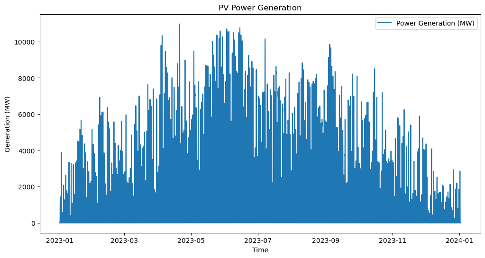
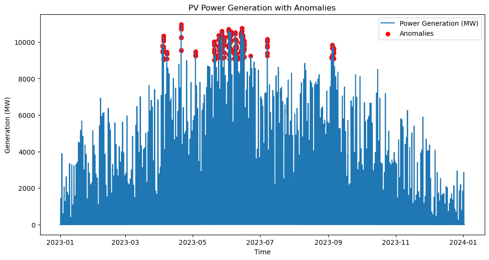
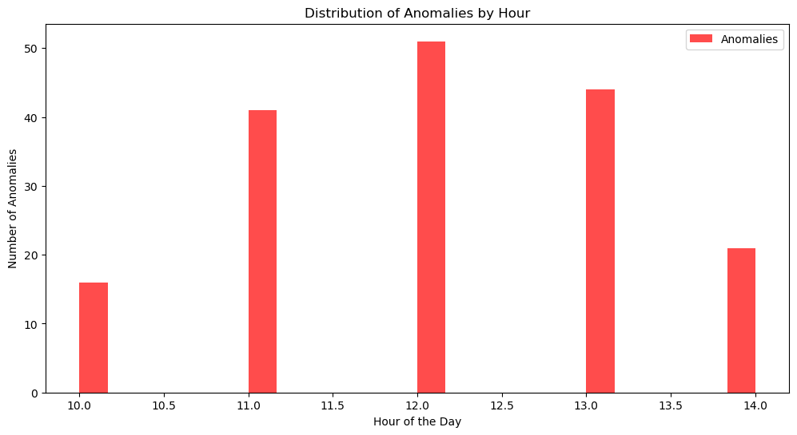
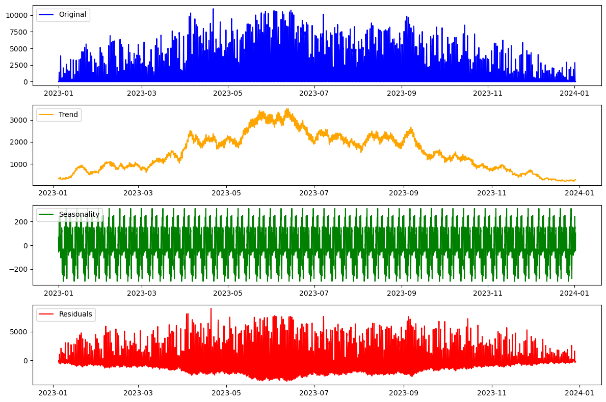
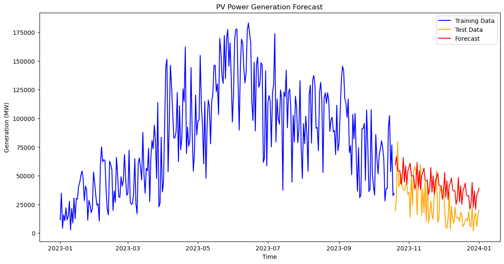
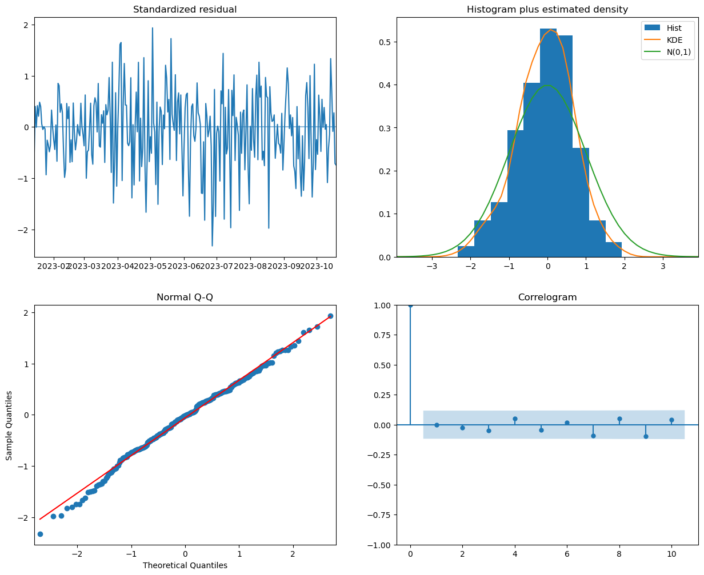

# PV_Live Anomaly Detection and Time Series Analysis

This project analyses one year of national solar PV generation estimates for Great Britain. It applies Isolation Forest to flag unusual half-hourly values, decomposes the series, and forecasts daily generation with a seasonal ARIMA (SARIMAX) model. All code is in [`PV_Live_Analysis.ipynb`](PV_Live_Analysis.ipynb).

---

## Dataset

* **Source:** [PV_Live](https://www.solar.sheffield.ac.uk/pvlive/), Sheffield Solar, University of Sheffield. Included here as `PV_Live Historical Results.csv`.
* **Coverage:** national GB aggregate (`gsp_id` 0), half-hourly, 1 January 2023 to 1 January 2024 (17,568 rows)
* **Columns:**
  * `datetime_gmt`: end of the half-hour period (GMT)
  * `generation_mw`: estimated PV generation (MW)
  * `lcl_mw`, `ucl_mw`: lower and upper confidence limits (MW)
  * `installedcapacity_mwp`, `capacity_mwp`: installed and effective capacity (MWp)

PV_Live values are estimates that Sheffield Solar may revise over time.

---

## Method (as implemented in the notebook)

1. **Preprocessing:** parse timestamps, sort, forward-fill the two missing confidence-limit values
2. **Isolation Forest:** fitted on standardised `generation_mw` only, with `contamination = 0.01` (1% of points flagged)
3. **Time of day of flagged points:** histogram of anomalies by hour
4. **Stationarity and decomposition:** ADF test (statistic -5.35, p < 0.001) and additive decomposition with `period = 365` half-hours
5. **Forecasting:** half-hourly values summed to daily totals; first 80% of days for training, last 20% for testing; `pmdarima.auto_arima` search, then SARIMAX(0,1,3)(0,1,1)[12]

---

## Results

### Generation over the year


### Isolation Forest



All flagged points fall between 10:00 and 14:00. With a single input feature, Isolation Forest flags the **highest** generation values, which occur around midday on sunny days. These are peaks, not evidence of faults.

### Decomposition


### SARIMAX forecast


* Training period: 1 January to 19 October 2023 (292 days); test period: the remaining 74 days
* **Test MAE: about 19,900** (in units of summed half-hourly MW per day; divide by 2 for MWh, about 9,900 MWh per day)
* The forecast is too high for most of November and December, when generation falls towards its winter minimum

Residual diagnostics:


The Ljung-Box (p = 0.97), Jarque-Bera (p = 0.23) and heteroskedasticity (p = 0.23) tests do not show clear problems with the residuals. statsmodels warns that the covariance matrix is near-singular, so standard errors of the coefficients may be unreliable.

---

## Limitations

* **Seasonal periods do not match the data.** The SARIMAX seasonal period of 12 means 12 **days** on daily data, which has no physical meaning. The decomposition period of 365 half-hours is about 7.6 days, not a year. A 7-day period, or yearly seasonality modelled with Fourier terms or more years of data, would fit better.
* **Anomalies are not faults.** The model has no information about weather or expected output, so it cannot separate low output caused by clouds from low output caused by a problem.
* **Only one year of data**, so annual seasonality cannot be learned from the series itself.

---

## Next Steps

* Detect anomalies on the ratio of generation to capacity, or on residuals from a clear-sky or weather-based expected output
* Use the confidence limits (`lcl_mw`, `ucl_mw`) to flag values outside the expected range
* Use several years of data and a 7-day or yearly seasonal term for forecasting
* Compare SARIMAX with a simple baseline, such as the same day last week

---

## How to Run

```bash
pip install -r requirements.txt
jupyter notebook PV_Live_Analysis.ipynb
```

## License

The code is released under the MIT License (see [LICENSE](LICENSE)). The PV_Live data belong to Sheffield Solar.
